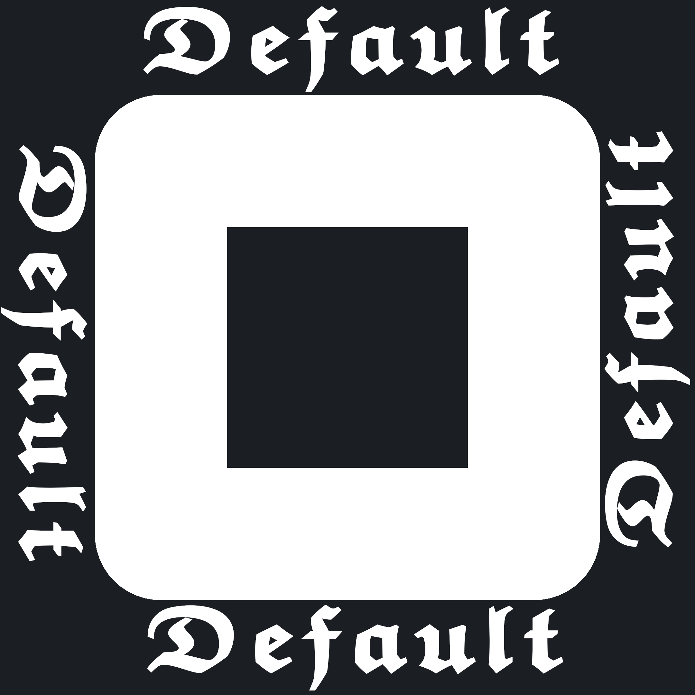

<div id="top"></div>
<a name="readme-top"></a>

[![Contributors][contributors-shield]][contributors-url]
[![Forks][forks-shield]][forks-url] [![Stargazers][stars-shield]][stars-url]
[![Issues][issues-shield]][issues-url]
[![MIT License][license-shield]][license-url]
[![Crates.io][crates-shield]][crates-url]

<!-- PROJECT LOGO -->
<br />
<div align="center">
  

<h1 align="center"></h1>

<p align="center">
    CHANGEME_DESC
    <p>
        <a href="https://github.com/CHANGEME_USER/CHANGEME_NAME/wiki"><strong>Explore the docs »</strong></a>
        <br />
        <br />
        <a href="https://github.com/CHANGEME_USER/CHANGEME_NAME#-video-showcase">View Demo</a>
        ·
        <a href="https://github.com/CHANGEME_USER/CHANGEME_NAME/issues">Report Bug</a>
        ·
        <a href="https://github.com/CHANGEME_USER/CHANGEME_NAME/issues">Request Feature</a>
    </p>
  </p>
</div>

<!-- TABLE OF CONTENTS -->
<details>
  <summary>Table of Contents</summary>
  <ol>
    <li>
      <a href="#overview">Overview</a>
      <ul>
        <li><a href="#features">Features</a></li>
        <li><a href="#video-showcase">Video showcase</a></li>
        <li><a href="#built-with">Built with</a></li>
        <ul>
          <li><a href="#core-dependencies">Core Dependencies</a></li>
        </ul>
      </ul>
    </li>
    <li>
      <a href="#getting-started">Getting Started</a>
      <ul>
        <li><a href="#running-the-program">Running the Program</a></li>
        <ul>
          <li><a href="#windows">Windows</a></li>
          <ul>
            <li><a href="#portable-exe">Portable EXE</a></li>
            <li><a href="#installer">Installer</a></li>
          </ul>
          <li><a href="#linux">Linux</a></li>
          <ul>
            <li><a href="#portable-bin">Portable Bin</a></li>
            <li><a href="#appimage">AppImage</a></li>
            <li><a href="#aur">AUR</a></li>
            <li><a href="#nix-file">Nix File</a></li>
            <li><a href="#deb-file">Deb File</a></li>
          </ul>
          <li><a href="#macos">MacOS</a></li>
          <ul>
            <li><a href="#portable-binary">Portable Binary</a></li>
            <li><a href="#app-folder">App Folder</a></li>
            <li><a href="#dmg-installer">DMG Installer</a></li>
            <li><a href="#homebrew">Homebrew</a></li>
          </ul>
          <li><a href="#all-platforms">All Platforms</a></li>
        </ul>
        <li><a href="#compilation">Compilation</a></li>
      </ul>
    </li>
    <li>
      <a href="#usage">Usage</a>
      <ul>
        <li><a href="#basics">Basics</a></li>
        <li><a href="#advanced">Advanced</a></li>
      </ul>
    </li>
    <li><a href="#road-map">Road Map</a></li>
    <li><a href="#contributing">Contributing</a></li>
    <li><a href="#faq">FAQ</a></li>
    <li><a href="#semver">Semver</a></li>
    <li><a href="#security">Security</a></li>
    <li><a href="#license">License</a></li>
    <li><a href="#contact">Contact</a></li>
    <li><a href="#template">Template</a></li>
    <li><a href="#acknowledgments">Acknowledgments</a></li>
  </ol>
</details>

## Overview

CHANGEME_MANUAL

If you have questions review the FAQ.

<p align="right">(<a href="#readme-top">back to top</a>)</p>

### Features

- [x] CHANGEME_MANUAL...

<p align="right">(<a href="#readme-top">back to top</a>)</p>

### Video showcase

[Showcase](CHANGEME_MANUAL)

<p align="right">(<a href="#readme-top">back to top</a>)</p>

### Built with

- [Rust 1.69.0](https://www.rust-lang.org/)

<p align="right">(<a href="#readme-top">back to top</a>)</p>

#### Core Dependencies

- CHANGEME_MANUAL

<p align="right">(<a href="#readme-top">back to top</a>)</p>

## Getting Started

### Running The Program

| Platform                         | Versions        |
| :------------------------------- | :-------------- |
| [Windows](#-windows)            | 7 and above     |
| [Linux](#-linux)                | Any modern distribution |
| [MacOS](#-macos)                 | 10.15 and above |
| [All Platforms](#-all-platforms) | All the above   |

<p align="right">(<a href="#readme-top">back to top</a>)</p>

---

### Windows

- [Portable EXE](#portable-exe)
- [Installer](#installer)

#### Portable EXE

1. Go to the [Releases Tab](https://github.com/CHANGEME_USER/CHANGEME_NAME/releases) and download the _CHANGEME_BIN-windows.exe_ file.
2. Double click the executable and the program will launch.
3. Review the Usage section for operational details.
4. Optionally create a desktop shortcut and a start-menu entry.

#### Installer

1. Go to the [Releases Tab](https://github.com/CHANGEME_USER/CHANGEME_NAME/releases) and download the _CHANGEME_BIN-windows-installer.exe_ file.
2. Execute the installer and follow the standard installation procedure.
3. A shortcut will be created in the start menu or on the desktop.
4. Review the Usage section for operational details.

<p align="right">(<a href="#readme-top">back to top</a>)</p>

---

### Linux

- [Portable Bin](#portable-bin)
- [AppImage](#appimage)
- [AUR](#aur)
- [Nix File](#nix-file)
- [Deb File](#deb-file)

<p align="right">(<a href="#readme-top">back to top</a>)</p>

#### Portable Bin

1. Go to the [Releases Tab](https://github.com/CHANGEME_USER/CHANGEME_NAME/releases) and download the _CHANGEME_BIN-linux_ file.
2. Execute the binary to launch the program.
3. Review the Usage section for operational details.
4. Optionally extract _CHANGEME_BIN-linux.tar.gz_ and place the desktop file in $HOME/.local/share/applications, icons in $HOME/.local/share/icons, and the binary in /usr/bin.

#### AppImage

1. Go to the [Releases Tab](https://github.com/CHANGEME_USER/CHANGEME_NAME/releases) and download the _CHANGEME_BIN-linux.AppImage_ file.
2. Execute the AppImage. Consider installing AppImageLauncher for integration.
3. Review the Usage section for operational details.

#### AUR

The packages are:

- CHANGEME_BIN (stable)
- CHANGEME_BIN-bin (precompiled)
- CHANGEME_BIN-git (source)

Using an AUR manager:

1. Install the package:
   ```shell
   paru -Sy CHANGEME_BIN
   ```
2. Launch CHANGEME_NAME from your application launcher.
3. Review the Usage section for operational details.

Manual build:

1. Install build dependencies:
   ```shell
   sudo pacman -Sy gcc base-devel --needed
   ```
2. Clone the build script:
   ```shell
   git clone https://aur.archlinux.org/CHANGEME_BIN.git
   ```
3. Build the package:
   ```shell
   makepkg
   ```
4. Install the package:
   ```shell
   sudo pacman -U CHANGEME_BIN-*.pkg.tar.zst
   ```

#### Nix File

1. Go to the [Releases Tab](https://github.com/CHANGEME_USER/CHANGEME_NAME/releases) and download the _CHANGEME_BIN-linux.nix_ file.
2. If using flakes, add it to your pkgs folder with your tag. Otherwise integrate into default.nix.
3. Review the Usage section for operational details.

#### Deb File

This method does not provide a desktop file; execute from the command line.

1. Go to the [Releases Tab](https://github.com/CHANGEME_USER/CHANGEME_NAME/releases) and download the _CHANGEME_BIN-linux.deb_ file.
2. Install:
   ```shell
   sudo dpkg -i CHANGEME_BIN-linux.deb
   ```
3. Execute CHANGEME_BIN from the terminal.
4. Review the Usage section for operational details.
5. Optionally extract _CHANGEME_BIN-linux.tar.gz_ and place the desktop file in $HOME/.local/share/applications and icons in $HOME/.local/share/icons.

<p align="right">(<a href="#readme-top">back to top</a>)</p>

---

### macOS

- [Portable Binary](#portable-binary)
- [App Folder](#app-folder)
- [DMG Installer](#dmg-installer)
- [Homebrew](#homebrew)

<p align="right">(<a href="#readme-top">back to top</a>)</p>

#### Portable Binary

1. Go to the [Releases Tab](https://github.com/CHANGEME_USER/CHANGEME_NAME/releases) and download the _CHANGEME_BIN-macos_ file.
2. Execute the binary to launch the program.
3. Review the Usage section for operational details.
4. Optionally place it in a dedicated location and create a shortcut.

#### App Folder

Similar to the portable binary, packaged with system icon assets.

1. Go to the [Releases Tab](https://github.com/CHANGEME_USER/CHANGEME_NAME/releases) and download the _CHANGEME_BIN-macos-app.tar.gz_ file.
2. Extract:
   ```shell
   tar -xzf CHANGEME_BIN-macos-app.tar.gz
   ```
3. Execute the application folder.
4. Review the Usage section for operational details.

#### DMG Installer

Standard DMG installation procedure.

1. Go to the [Releases Tab](https://github.com/CHANGEME_USER/CHANGEME_NAME/releases) and download the _CHANGEME_BIN-macos-installer.dmg_ file.
2. Execute the DMG.
3. Drag the application to the Applications folder.
4. The application will appear in Launchpad.
5. Review the Usage section for operational details.

#### Homebrew

This method does not create a desktop entry. Execute via command line or create a shortcut.

1. Install Homebrew if not present:
   ```shell
   /bin/bash -c "$(curl -fsSL https://raw.githubusercontent.com/Homebrew/install/HEAD/install.sh)"
   ```
2. Add the tap repository:
   ```shell
   brew tap CHANGEME_USER/tap
   ```
3. Install the package:
   ```shell
   brew install CHANGEME_BIN
   ```
4. Review the Usage section for operational details.

<p align="right">(<a href="#readme-top">back to top</a>)</p>

---

### All Platforms

This method works across Linux distributions, Windows 10/11, and macOS (Big Sur+).

1. Install Rust via the official rustup installer or a package manager.
2. Execute:
   ```shell
   cargo install CHANGEME_BIN
   ```
3. Ensure .cargo/bin is in your PATH. On Linux and macOS add to your shell RC file:
   ```shell
   export PATH=$HOME/.cargo/bin:$PATH
   ```
   On Windows the path is automatically added; restart if recently installed.
4. Optionally create a symlink (Linux/macOS) or shortcut (Windows) for direct access.
5. Update by re-running the install command.
6. Optionally create a start-menu shortcut.

<p align="right">(<a href="#readme-top">back to top</a>)</p>

---

### Compilation

This program uses cross-platform libraries. Rust installation is required.

1. Clone the repository:
   ```shell
   git clone https://github.com/CHANGEME_USER/CHANGEME_NAME.git
   ```
   Alternatively download and extract the ZIP archive.
2. Navigate to the repository directory.
3. Build:
   ```shell
   cargo build --release
   ```
   Build time varies based on system optimization.
4. The executable is located at target/release/CHANGEME_BIN.

<p align="right">(<a href="#readme-top">back to top</a>)</p>

## Usage

See the video showcase for a complete operational breakdown.

### Basics

CHANGEME_MANUAL

### Advanced

CHANGEME_MANUAL

<p align="right">(<a href="#readme-top">back to top</a>)</p>

## Road Map

The roadmap is located in the Projects tab or at [this link](https://github.com/users/CHANGEME_USER/projects/CHANGEME_MANUAL).

<p align="right">(<a href="#readme-top">back to top</a>)</p>

## Contributing

Contributions are welcome.

Review CONTRIBUTING.md and CODE_OF_CONDUCT.md. The process is: edit a file, submit a pull request. Changes will be evaluated and merged if appropriate. Maintain respectful conduct.

<p align="right">(<a href="#readme-top">back to top</a>)</p>

## FAQ

CHANGEME_MANUAL

1. Question 1
   - Answer 1

<p align="right">(<a href="#readme-top">back to top</a>)</p>

## Semver

CHANGEME_NAME follows Semantic Versioning 2.0.

<p align="right">(<a href="#readme-top">back to top</a>)</p>

## Security

If you discover issues review SECURITY.md and follow its procedures.

<p align="right">(<a href="#readme-top">back to top</a>)</p>

## License

Distributed under the MIT License.

<p align="right">(<a href="#readme-top">back to top</a>)</p>

## Contact

Submit an issue or contact via email: CHANGEME_SMAIL

<p align="right">(<a href="#readme-top">back to top</a>)</p>

## Template

This repository is based on Obscurely/RustTemplate.

<p align="right">(<a href="#readme-top">back to top</a>)</p>

<!-- MARKDOWN LINKS & IMAGES -->

[contributors-shield]: https://img.shields.io/github/contributors/CHANGEME_USER/CHANGEME_NAME.svg?style=for-the-badge
[contributors-url]: https://github.com/CHANGEME_USER/CHANGEME_NAME/graphs/contributors
[forks-shield]: https://img.shields.io/github/forks/CHANGEME_USER/CHANGEME_NAME.svg?style=for-the-badge
[forks-url]: https://github.com/CHANGEME_USER/CHANGEME_NAME/network/members
[stars-shield]: https://img.shields.io/github/stars/CHANGEME_USER/CHANGEME_NAME.svg?style=for-the-badge
[stars-url]: https://github.com/CHANGEME_USER/CHANGEME_NAME/stargazers
[issues-shield]: https://img.shields.io/github/issues/CHANGEME_USER/CHANGEME_NAME.svg?style=for-the-badge
[issues-url]: https://github.com/CHANGEME_USER/CHANGEME_NAME/issues
[license-shield]: https://img.shields.io/github/license/CHANGEME_USER/CHANGEME_NAME.svg?style=for-the-badge
[license-url]: https://github.com/CHANGEME_USER/CHANGEME_NAME/blob/master/LICENSE
[crates-shield]: https://img.shields.io/crates/v/CHANGEME_BIN.svg?style=for-the-badge
[crates-url]: https://crates.io/crates/CHANGEME_BIN
